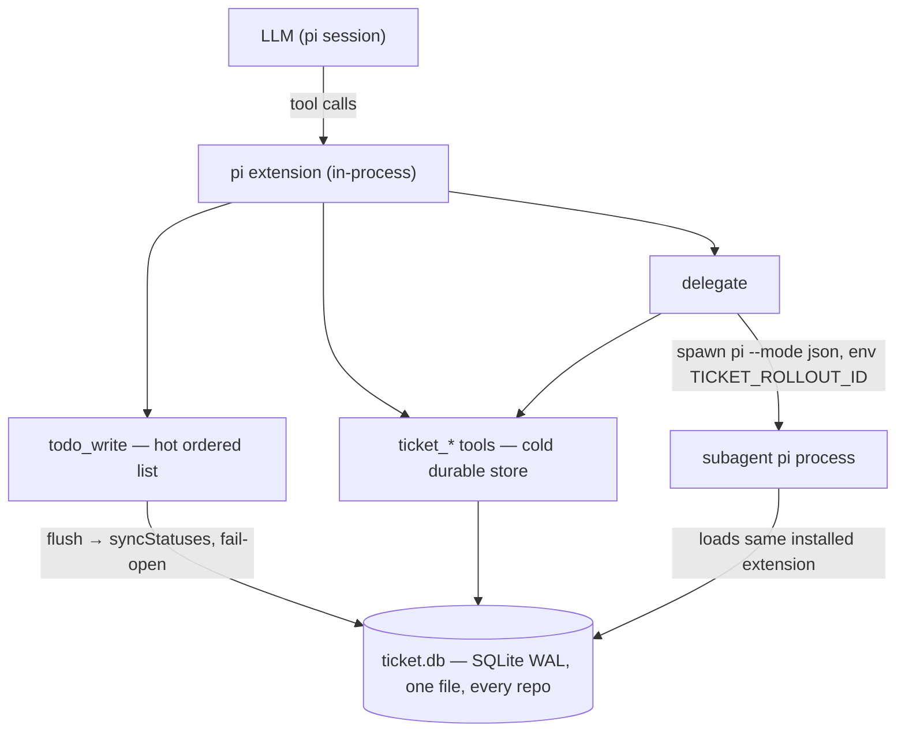

# Design — tickets, todos, delegation for pi

*The architecture and the decisions behind pi-ticketing: the hot/cold split,
ground-truth identity, the corrected_call envelope, details-based todo state,
the fail-open mirror, and namespace injection. The repo README is the short
version; this is the why.*

# pi-ticketing — design

Tickets, a todo list, and delegation for pi. Three capabilities pi does not
ship, built as one package: a durable SQLite ticket store, a flush-based todo
list, and subagent delegation with injected ticket namespaces.

## Goal

An agent working a long-lived engineering task needs three registers:

- **Cold** — the ticket: an immutable record with an append-only comment
  stream, durable across sessions, repos, and worktrees.
- **Hot** — the todo list: cheap, ordered, per-session ordering that survives
  branching and forking but is not the record.
- **Hands** — delegation: spawned subagents that work a ticket in an isolated
  context and report back.

The design rule that keeps them honest: **the todo list mirrors onto tickets;
tickets never mirror onto the todo list.** Hot state is disposable; the cold
store is the record.

## Layout

```
pi-ticketing/
  package.json               # pi-package manifest (peerDependencies, zero runtime deps)
  extensions/
    index.ts                 # entry: store singleton, session lifecycle, 7 ticket tools
    schemas.ts               # TypeBox schemas — misuse unrepresentable at the harness layer
    todo-tool.ts             # todo_write — hot list, delegatee refusal, fail-open mirror
    delegate-tool.ts         # delegate — spawned pi subagents, injected namespaces
    render.ts                # /tickets overlay (grouped by status, Escape closes)
    lib/
      ticket.ts              # the contract: handlers, envelope, help/rules text
      ticket-store.ts        # TicketStore (node:sqlite), TABLE ticket + ticket_comment
      session.ts             # rollout-id resolution (env > captured session id)
      sync.ts                # the todo→ticket mirror, in-process, fail-open
      ticket.test.ts         # the contract tests
  skills/ticketing/SKILL.md  # the flow + delegation doctrine
  DESIGN.md, README.md
```

## Architecture



### The store (`lib/ticket-store.ts`)

- `node:sqlite` (`DatabaseSync`), WAL mode — works on both Node ≥ 22.5 and
  Bun, so the package needs **zero runtime dependencies**.
- One DB file outside every repo: `~/.pi/agent/ticketing/ticket.db`,
  overridden by `TICKET_DB_HOME`. The autoincrement id is the only global
  ticket number; every session on every project shares the store.
- Two tables: `ticket` (immutable row: `todo` one-liner, `md_content` body,
  `status`, `rollout_id` owner, `last_actor`) and `ticket_comment`
  (append-only, ≤1000 chars, `CHECK`-enforced by the schema).
- The store is a lazy singleton: opened on first use, closed on
  `session_shutdown`. If the DB home is unwritable, the store returns null and
  every tool reports a structured failure — the todo flush still succeeds
  (fail-open).

### Identity (`lib/session.ts`)

`rollout_id` IS the session id — one id, no other. Owners and comment authors
are **stamped from ground truth, never taken from model input**:

1. `TICKET_ROLLOUT_ID` env — injected by the delegate tool when it spawns a
   subagent; a delegatee's writes land in its delegated namespace.
2. The pi session id, captured once at `session_start` / `session_tree`.

Only two tools accept an id as input, deliberately: `ticket_status` (the
owner gate) and `ticket_list` (cross-session adoption).

### The contract (`lib/ticket.ts`)

Pure module — no pi, no typebox imports — so it unit-tests on a bare runtime.
One tool per action; every failure returns the
`{ code, message, corrected_call }` envelope, where `corrected_call` is the
COMPLETE call: received values kept, missing ones filled with real ids
wherever they are derivable. A failing model re-emits it verbatim and
succeeds. Stable codes: `E_ADD_MISSING_TODO`, `E_ADD_NO_IDENTITY`,
`E_NO_TICKET`, `E_BAD_ID`, `E_LIST_SCOPE`, `E_BAD_STATUS`,
`E_COMMENT_TOO_LONG`, `E_STATUS_REFUSED`, `E_STORE_UNAVAILABLE`, …

### The schema layer (`schemas.ts`)

TypeBox schemas with `additionalProperties: false` are validated by pi at the
harness layer before `execute()` runs: wrong types, illegal enum values,
unknown keys, and over-long comments are rejected before any handler code.
The handlers keep semantic checks as defense in depth. Status enums use
`StringEnum` (a plain JSON `enum` every provider accepts).

### `todo_write` — the hot list (`todo-tool.ts`)

- **State lives in tool-result `details`** (`{ action, todos, changed }`), so
  it is automatically correct when you branch or fork a session;
  `reconstructState` replays `ctx.sessionManager.getBranch()` on
  `session_start` / `session_tree`.
- **Flush semantics**: the call replaces the list wholesale. Each item backed
  by a ticket starts `"N: …"`; the number is the item's permanent id — never
  renumbered.
- **The mirror**: every flush calls `store.syncStatuses(items, rolloutId)` in
  a `try/catch` — closing item `N: …` moves ticket N's status, scoped to the
  flushing session, fail-open. A broken store never breaks the flush.
- **Single writer, enforced**: if `TICKET_ROLLOUT_ID` is set (we are a
  delegatee), the tool returns a refusal envelope pointing at
  `ticket_comment` instead of flushing.

### `delegate` — the hands (`delegate-tool.ts`)

- Spawns a separate `pi --mode json -p --no-session` process per task with an
  isolated context window. Modes: single (`{ id, task? }`), parallel
  (`{ tasks: [...] }`, capped), sequential chaining via repeated singles.
- **The ticket number is the contract**: the launch prompt names the ticket
  and the owner's session id; the delegatee's first calls are `ticket_get`
  and `ticket_rules`.
- **Namespace injection**: each task gets `rolloutId = <ticket>-<uuid8>`,
  passed as `TICKET_ROLLOUT_ID` in the spawned env and named in the prompt.
  The same installed extension loads inside the subagent, `session.ts`
  resolves the env var first — so a delegatee's writes land in the delegated
  namespace without trusting caller input.
- **On completion**: the tool appends a go/no-go `ticket_comment` (fail-open)
  summarizing status and usage; the orchestrator burndowns the todo item and
  commits. Constants worth keeping: parallelism cap, per-task output cap,
  per-task kill timer, usage-stats aggregation.

### `/tickets` — the overlay (`render.ts`)

A modal TUI component fed by `store.list()` for the current rollout id
(`all` shows every session's), grouped by status, Escape closes.

## Key design decisions (why)

1. **In-process, not a spawned server.** pi loads extensions via jiti inside
   its own process. No stdio loop, no subprocess hooks, no handshake — the
   mirror is a function call, and the store is one `require` away from every
   tool.
2. **`node:sqlite`, not a driver.** Zero runtime dependencies; the store
   loads wherever pi loads. The trade: Bun's runtime does not ship
   `node:sqlite`, so tests run under `node --test` — pi itself runs on Node,
   which is the only runtime that matters in-process.
3. **Ground-truth identity.** Every stamping decision reads the harness, not
   the model. The two id-taking tools are the deliberate exceptions, and both
   are gates: one ownership, one adoption.
4. **Details-based todo state.** Session-tree state is the only state that is
   branch-correct for free; a file or DB would need explicit fork handling.
5. **The mirror is fail-open, always.** Cold storage must never corrupt hot
   ordering. `syncStatuses` failures are reported in the tool result and
   dropped.
6. **Schema-compatible DB.** The tables are plain SQLite with CHECKs; any
   other tool can read the same file. Set `TICKET_DB_HOME` to share one store
   across harnesses.
7. **Versioning habit.** Tag `v<pi-version>-<short-sha>` against the pi
   release you tested with.
